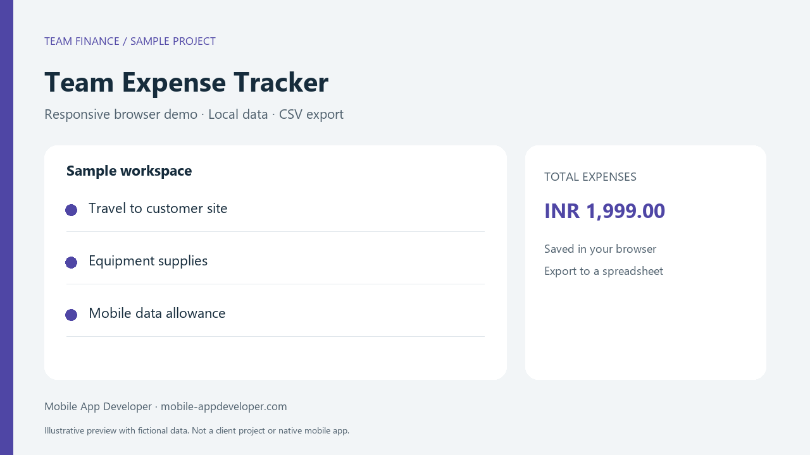

# Team Expense Tracker

A responsive browser demo for recording team expenses in INR, calculating totals, and exporting spreadsheet-ready CSV.



**Sample project:** This is a browser prototype with fictional data, created as a learning and portfolio example. It is not a client case study, production system, or native Android, iOS, or Flutter application. The image above is an illustrative preview, not a captured screenshot.

## Why this example exists

Teams need a straightforward record of small expenses that can be moved into a spreadsheet.

## Features

- Record expenses in INR
- Calculate the total using integer paise
- Remove individual expenses
- Export spreadsheet-ready CSV

## Run the demo

Download the repository ZIP, extract it, and open `index.html` in a modern browser. No package installation, backend, API key, or build step is required. For a stable browser-storage origin, use GitHub Pages or a local HTTP server. Storage behavior for files opened directly can vary by browser.

If Python is installed, run `python -m http.server 8000` from this folder and open `http://localhost:8000`.

## Try the workflow

1. Review the three fictional sample entries.
2. Add an entry with an INR amount.
3. Export CSV and open it in a spreadsheet.
4. Reload the page to see saved entries when browser storage is available.
5. Use Reset sample to replace current entries with the original demo data.

## Implementation and limits

- Semantic HTML, responsive CSS, and dependency-free JavaScript.
- Local browser storage with a separate key for this demo; storage failures show a message.
- User-entered descriptions are rendered as text, not HTML.
- CSV output quotes cells and prefixes potentially formula-like text with an apostrophe.
- No network requests, accounts, server persistence, Google Sheets API integration, or synchronization.
- No service worker is included: a hosted page is not guaranteed to reload offline. A downloaded copy can run locally.
- Use fictional data. This demonstration is not intended for sensitive business records.
- Amounts are stored in integer paise. Maximum individual entry: INR 1,000,000.

## Files

```text
index.html
styles.css
app.js
README.md

  team-expense-tracker-demo-preview.png
  team-expense-tracker-demo-preview.svg
```

## Images

The PNG is ready for README display and portfolio upload. The SVG is an editable original vector illustration. Both are labelled as sample previews. For actual screenshots, run the demo and capture its visible UI with fictional data. Update the relative image path above if you change the filename.

## About Mobile App Developer

[Mobile App Developer](https://mobile-appdeveloper.com) is a small remote team of developers, designers, and testers based in India, building Android, iPhone, and Flutter apps for businesses in the USA, Australia, and India.

## Publishing

Upload these files at the root of a public GitHub repository. To host the demo, choose Settings → Pages → Deploy from a branch → main → /(root). Use the URL GitHub displays after deployment. Add that live demo URL near the top of this README once it exists.

## Licensing

No open-source license has been selected for this package. Before public release, the repository owner should choose a license if they want to grant reuse rights. Public visibility alone is not an open-source license.

